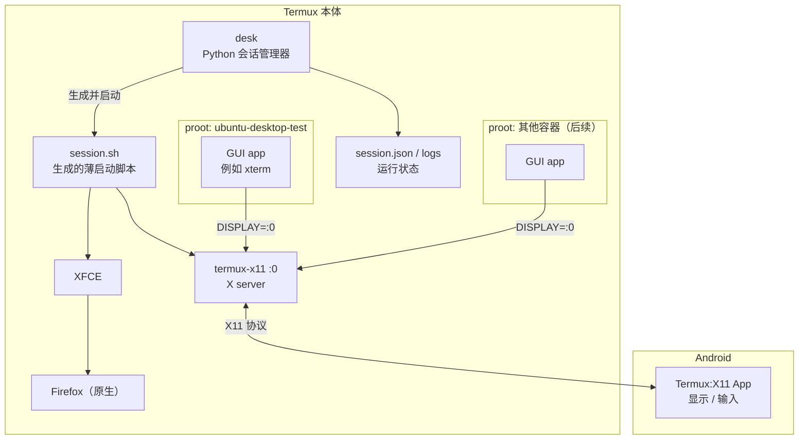
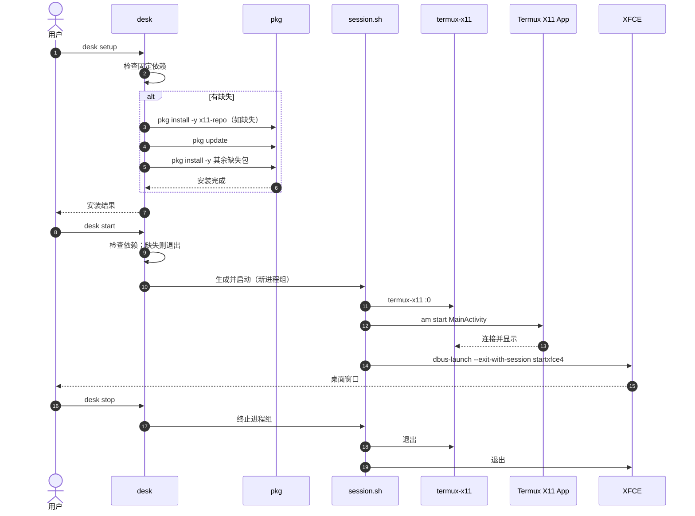
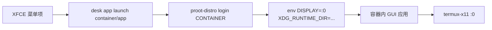
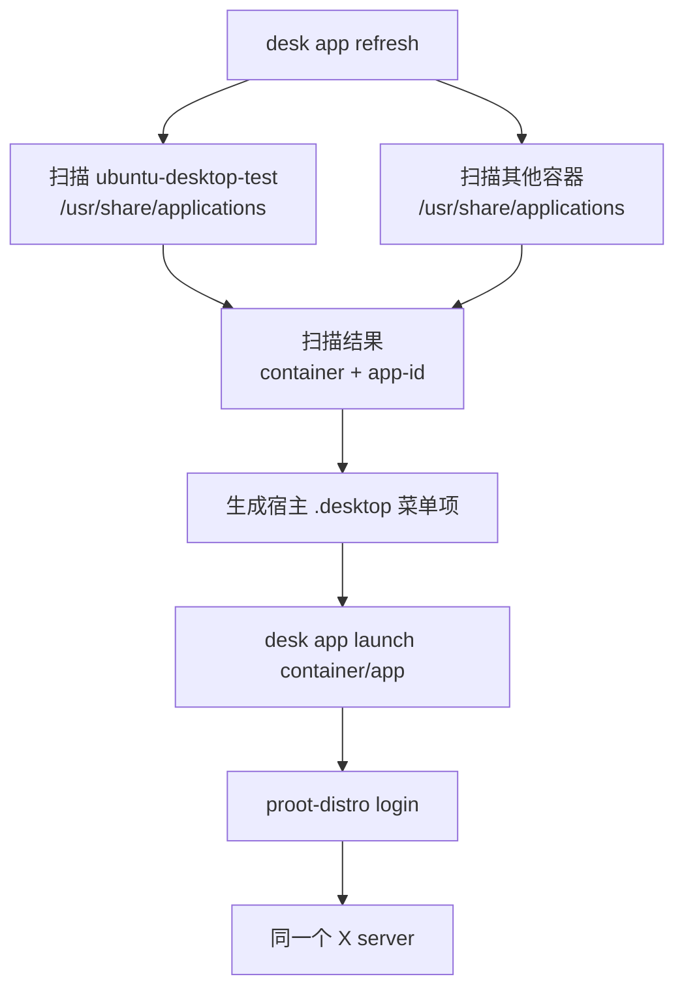

# 架构

> 状态：设计文档，未实现。
> 本文描述目标架构、M0 的会话启动顺序，以及 M2/M3 中 proot 应用的接入方向。

## 1. 术语

- **会话（session）**：一次桌面运行实例，包含 X server、XFCE 和相关进程。
- **会话管理器**：`desk` 命令，负责启动、停止、检查状态和清理会话；不负责画界面。
- **容器（container）**：一个 proot rootfs，例如 `ubuntu-desktop-test`。
- **应用（app）**：容器内或 Termux 原生的 GUI 程序。应用属于某个容器，或属于宿主。
- **X server**：`termux-x11` 进程，监听 `:0`。
- **Termux:X11 App**：Android 端的显示/输入前端，不是 X server。

## 2. 目标架构



核心边界：

- 桌面只有一个，所有 GUI 客户端连同一个 X server。
- 容器不是桌面边界，只是应用来源。
- 切换容器只影响某个应用从哪个 rootfs 启动，不影响桌面本身。

## 3. M0：安装依赖并启动 XFCE

M0 包含两部分：

1. `desk setup` 安装固定的 Termux 依赖。
2. `desk start` 启动 XFCE 会话。

`desk start` 永远不安装依赖。



M0 的安装范围：

- 只安装：`x11-repo`、`termux-x11-nightly`、`xfce4`、`dbus`、`termux-am`
- 只安装缺失的包，不执行 `pkg upgrade`
- 不安装 Termux:X11 Android App；APK 由用户手动安装，`doctor` 检查并给下载地址
- 不安装 Firefox、proot、GPU 驱动、主题

M0 进程模型：

- `desk start` 用 `start_new_session=True` 启动 `session.sh`，记录 PGID。
- `desk stop` 只对 PGID 发 `SIGTERM`，超时后再 `SIGKILL`。
- 如果进程组清理后仍有残留，`desk stop` 报错并保留状态，不使用 `pkill -f` 全局搜索进程。
- `desk status` 读取 `session.json`，用进程组和会话标识检查存活。
- `desk logs` 读取会话日志。
- 不做常驻 supervisor；`desk start` 启动后退出。
- 状态记录 boot id、会话标识和会话进程的启动时间；`stop` 和 `status` 先验证这些事实，验证不了就拒绝操作并保留状态。
- `start` 和 `stop` 通过状态目录上的文件锁串行执行。

M0 使用的状态与日志位置：

```text
~/.local/state/termux-desktop/session.json
~/.local/state/termux-desktop/desk.log
```

## 4. M2：proot 应用接入

M2 只支持一个容器和一个手写菜单项，用于验证容器 GUI 能否显示。



启动参数方向：

```text
proot-distro login <container> \
  --shared-tmp \
  -- env DISPLAY=:0 <app>
```

- M2 使用 `--shared-tmp`，让容器访问 X11 socket。
- M2 不使用 `--shared-home`。
- M2 的 X11 认证先用 `xhost +` 跑通，后续收紧。
- M2 的应用进程需要被会话记录，`desk stop` 才能清理干净。

M2 验收应用：`xterm`。它是容器内的 X11 终端，能打开就说明从容器到 X server 的显示路径通了。

## 5. M3：多容器与菜单聚合

M3 目标：应用安装在不同容器中，菜单统一展示。



应用标识建议：

```text
<container>/<app-id>
```

例如：

```text
ubuntu-desktop-test/xterm
debian-dev/gimp
```

菜单项需要带容器名，避免同名应用混淆。

M3 暂不决定：

- `.desktop` 的 `Exec` 解析范围
- 图标复制策略
- 重复应用的合并规则
- 自动扫描的缓存与刷新频率

## 6. 文件系统与进程间通信

### home

- **不共享 home**。每个容器使用自己的 root home。
- 不使用 `--shared-home`，避免不同发行版的应用配置互相覆盖。
- 项目定义容器文件系统的主要挂载和路径约定；默认不预设共享目录。
- 用户可以在项目约定的挂载点之上绑定自定义目录。
- 容器 rootfs 本身隔离 home，不需要额外的“每容器桌面用户”来实现配置隔离。

### /tmp 和 X11

`--shared-tmp` 的语义：

```text
宿主 $PREFIX/tmp  ←→  容器 /tmp
```

`--shared-x11` 的语义：

```text
宿主 $PREFIX/tmp/.X11-unix  ←→  容器 /tmp/.X11-unix
```

`--shared-tmp` 包含 `--shared-x11`。proot-distro 默认模式下两者已经启用；`--isolated`/`--minimal` 才需要显式声明。

共享 tmp 的影响：

- 好处：X11 socket 直接可见，后续音频/DBus 也容易接。
- 风险：多个容器共享同一个 `/tmp`，临时文件、socket、锁可能冲突。
- 风险：容器和宿主可以互相读写临时文件。
- 风险：残留的 `.X0-lock`、`.X11-unix/X0` 可能导致下次启动失败。
- 结论：M2 先用 `--shared-tmp`；M3 推荐改成 `--shared-x11` + 每容器独立 `/tmp` bind，但需要验证。

## 7. 身份与权限模型

本项目的工程假设：

- **不把 Android/Unix 用户权限当作本项目的隔离机制。**
- Android 仍有 app sandbox、SELinux 和存储限制；这些是平台约束，不是本项目可设计的权限层。
- proot 内的 `root` 是容器内的身份映射；落到宿主仍是 Termux 应用 UID，不是宿主 root。
- 容器内的文件写入最终仍受 Termux 应用 UID 和 Android 限制约束。
- 因此 proot 不是安全沙箱，容器之间也不是强安全边界。

基于这个模型：

- M2 起使用容器内 root 运行应用，使用每容器独立的 root home。
- 暂不创建“每容器专用桌面用户”；它不能提供真正的安全隔离，还会引入 UID 映射和文件权限复杂度。
- 如果后续某个应用拒绝 root，或需要独立的用户级配置，再按需引入专用用户。
- 不给“专用用户”赋予安全承诺；它只是应用行为和配置管理上的选择。

## 8. 进程、状态与清理

- 所有会话进程放在同一个进程组。
- `desk` 记录会话 PGID，以及通过它启动的应用 PID。
- `desk stop` 先终止应用，再终止桌面和 X server。
- M0 只按进程组清理，不按命令名搜索并杀进程。
- 如果进程组清理后仍有残留，`desk stop` 报错并保留状态；这表示启动方式需要修，不能用 `pkill -f` 掩盖。
- 状态文件只记录可验证的事实：PID、PGID、display、启动时间、日志路径、boot id、会话标识、会话进程的启动时间。
- 日志是排障入口，不是状态来源。

## 9. 约束

- 只支持同 CPU 架构的 proot 容器；x86 应用需要 box64/qemu，当前不做。
- 只支持 X11/XWayland 应用；纯 Wayland 不在 MVP。
- 不做 VNC、音频、GPU、chroot。
- 不修改用户的 shell 启动文件。
- 所有运行和验证都在 Termux 本体完成；不要在另一个 proot 容器里嵌套验证桌面。

## 10. 参考项目

参考项目是“安装器 + 配置生成器 + 启动脚本集合”，不是桌面运行时。它覆盖 14 种 DE/WM、2 种 GUI 模式、2 种包管理器、2 种容器和多种 GPU 驱动，复杂度主要来自这些维度的组合。

我们只借用：

- `tx11start` 的启动顺序
- `TracerPid` 的 proot 防护思路
- `pdrun` 的容器环境包装思路
- 系统检查和故障排查项

详见 [参考项目笔记](reference.md) 和 [决策记录](decisions.md)。
