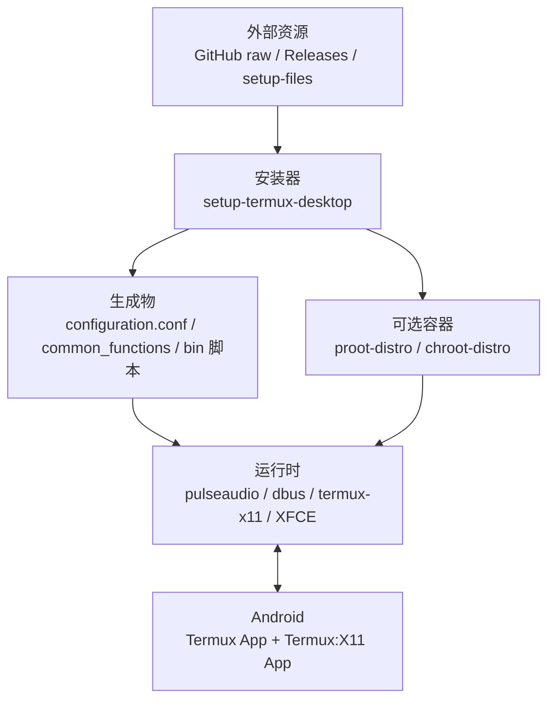
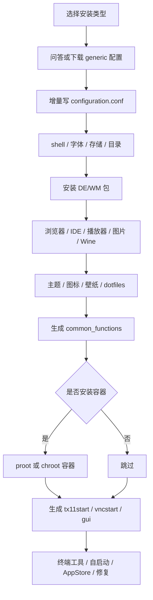
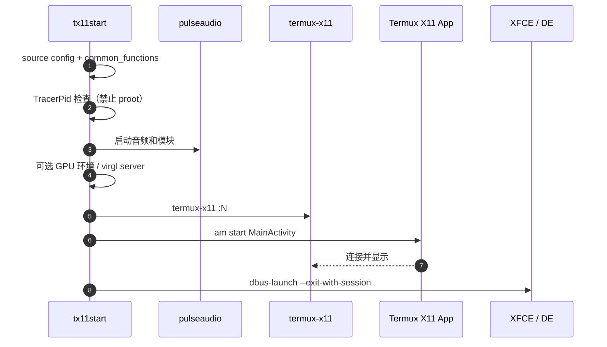
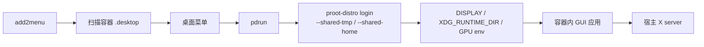

# 参考项目笔记：sabamdarif/termux-desktop

> 调研对象：`sabamdarif/termux-desktop`，`main` 分支，提交 `59f6696`。
> 本文件只记录理解和可借鉴的流程，不复制其代码。

## 1. 它是什么

`termux-desktop` 不是桌面运行时，而是：

> **安装器 + 配置生成器 + 一组生成出来的启动脚本。**

安装器本身不常驻。真正运行时执行的是它生成到 `$PREFIX/bin` 下的脚本。

## 2. 组成

| 组件 | 作用 |
|---|---|
| `setup-termux-desktop` | 主安装器/管理器，约 6.5k 行 Bash |
| `enable-hw-acceleration` | GPU 驱动选择和环境变量 |
| `distro-container-setup` | proot/chroot 容器、应用包装、菜单集成 |
| `add2menu` | GTK3 Python 应用，把容器 `.desktop` 转成宿主菜单项 |
| `docs/`、`configuration/`、`other/` | 文档、预设配置、shell/终端配置 |
| `setup-files` 分支 | 主题、图标、壁纸等外部资源 |

## 3. 分层



关键生成物：

```text
$PREFIX/etc/termux-desktop/configuration.conf
$PREFIX/etc/termux-desktop/common_functions
$PREFIX/bin/tx11start
$PREFIX/bin/tx11stop
$PREFIX/bin/vncstart
$PREFIX/bin/vncstop
$PREFIX/bin/gui
$PREFIX/bin/pdrun
$PREFIX/bin/<distro>
$PREFIX/share/applications/pd_added/
$HOME/termux-desktop.log
```

## 4. 安装流程



特点：

- 配置不是一次性生成，而是各阶段增量写入。
- Generic 安装也会落到同一套安装函数。
- `--change` 会重新加载配置并重新生成对应脚本。
- 主题、驱动、AppStore 都依赖网络资源。

## 5. 运行时启动顺序



`gui` 只是调度器：

- `gui --start` → `tx11start`
- `gui --start vnc` → `vncstart`（Both 模式）
- `gui --display` → 远程 X server
- `gui --kill` → 清理 X11/VNC

## 6. 容器接入



特点：

- 容器只提供应用，桌面仍在 Termux 本体。
- `pdrun` 默认走 GPU 环境，`--nogpu` 切软件渲染。
- 使用 `xhost +` 放开 X11 访问。
- `add2menu` 是独立的 GTK3 程序。
- 所有入口都有 proot 嵌套检查。

## 7. 复杂度来源

- 14 种 DE/WM
- 2 种 GUI 模式
- APT / Pacman
- proot / chroot
- 多组 Vulkan / OpenGL 驱动
- 主题、图标、壁纸、AppStore 等外部资源
- 单体 Bash + 运行时生成 Bash
- `configuration.conf` 同时是数据和代码

## 8. 可以借鉴的部分

- `tx11start` 的启动顺序
- `TracerPid` 检查，防止嵌套 proot
- proot 应用的环境包装方式
- 系统检查项：Termux:X11、Termux:API、GPU、存储、Android 版本
- 容器应用“桌面菜单化”的产品思路

## 9. 不照搬的部分

- 单体 Bash 主逻辑
- 14 种 DE/WM 的所有组合
- 主题/图标/AppStore 体系
- 运行时从 GitHub 拉取并 `source` 远程脚本
- 以 `pkill -f` 为主的进程管理
- 全量 `--shared-tmp` 作为长期方案
- 共享 home

## 10. 许可

参考项目使用 GPLv3。本笔记只做架构和流程分析；如果未来复制其代码片段并分发，需要重新评估本项目的许可证。
